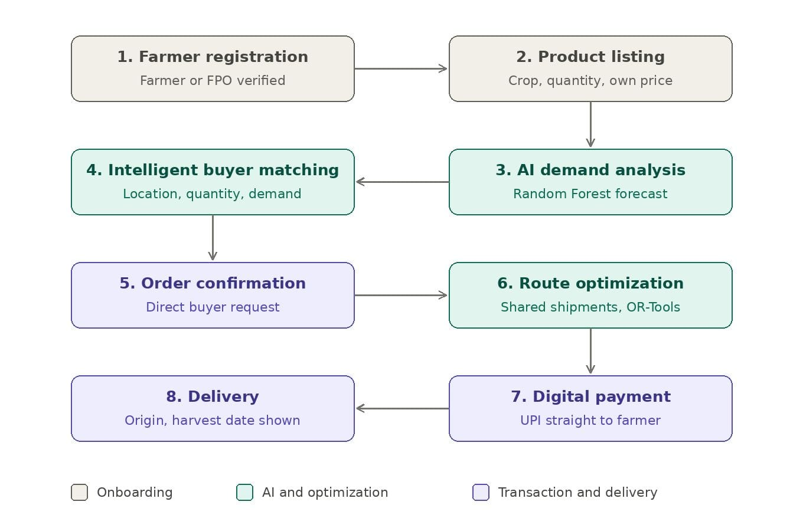

# Smart India Hackathon Workshop
# Date:25.11.2026
## Reference Number:26019255
## Name: Dhivakar P A

## Problem Title
SIH 26033: Multiple intermediaries reduce farmers earnings and increase consumer prices.

## Problem Creater's Organization
Ministry of Consumer Affairs, Food & Public Distribution

## Theme
Agriculture, FoodTech & Rural Development

## Problem Description
Expected Solution: Create a digital marketplace that:

1. Connects farmers/FPOs directly with consumers and bulk buyers.
2. Provides logistics support.
3. Uses AI for demand forecasting and route optimization.

Benefits:

1. Better prices for farmers.
2. Lower prices for consumers.
3. Reduced supply chain inefficiencies.

## Proposed Solution
AgriConnect AI is a smart agricultural trading platform designed to establish a direct connection between farmers, Farmer Producer Organizations (FPOs), consumers, wholesalers and commercial buyers.

1. Digital Agricultural Marketplace: Enables farmers to advertise available   crops, specify quantities, fix selling prices and receive purchase requests directly.
2. Intelligent Buyer Matching: Uses AI to recommend suitable buyers based on location, crop availability, quantity and market demand.
3. Predictive Market Analysis: Analyses previous sales, seasonal requirements and agricultural market data to estimate future demand.
4. Collective Selling: Allows small-scale farmers to combine their produce to fulfil large orders and share transportation expenses.
5. Optimized Transportation: Identifies efficient delivery routes and coordinates multiple agricultural shipments.
6. Digital Produce Verification: Provides buyers with information about produce origin, harvest date and seller details.
7. Regional Language Assistance: Supports farmers through a simplified interface and multilingual accessibility.

Innovation: Integrates intelligent buyer matching, collective selling, predictive analytics and collaborative transportation into a single farmer-centric platform.

## Technical Approach
Component and Technical approach:
1. User Interface: React.js, Tailwind CSS 
2. Backend Development: Python, FastAPI 
3. Database Management: Supabase PostgreSQL 
4. Machine Learning: Pandas, Scikit-learn, Random Forest 
5. Location Services: OpenStreetMap, Leaflet 
6. Logistics Optimization: Google OR-Tools 
7. User Authentication: Supabase Auth 
8. Digital Transactions: UPI Payment Integration
9. Cloud Deployment: Vercel, Render 

Implementation Workflow

## Feasibility and Viability
1. *Technical Feasibility:*  

The proposed system uses widely available web frameworks, open-source machine learning algorithms and cloud-based database services. These technologies support the development of an affordable and functional prototype.

2. *Financial Viability:*  

The platform aims to minimize operational expenses by reducing unnecessary intermediary charges. Revenue opportunities include nominal service charges, premium business accounts and transportation partnerships.

3. *Potential Challenges:*

1. Limited awareness of digital platforms among farmers.
2. Inconsistent internet availability in rural regions.
3. Seasonal fluctuations in agricultural supply and demand.
4. Maintaining product freshness during transportation.
5. Establishing trust between farmers and buyers.

4. *Strategies to Overcome Challenges:*

1. Provide simplified navigation and regional-language assistance.
2. Introduce farmer verification and buyer rating systems.
3. Collaborate with local FPOs and transportation providers.
4. Enable lightweight interfaces for slower internet connections.
5. Use demand prediction to support better inventory planning.

5. Scalability:  

 The platform can initially be introduced in selected agricultural villages and gradually expanded across districts and states by establishing regional distribution networks.

## Impact and Benefits
1. *Economic Impact: Improved Farmer Income*

Creates better selling opportunities, reduces unnecessary commissions and gives farmers greater control over their product prices.

2. *Social Impact: Empowerment of Rural Communities*

Encourages digital participation, supports small-scale farmers and improves access to larger agricultural markets.

3. *Consumer Benefits: Affordable and Reliable Products*

Provides access to fresh agricultural produce with transparent pricing and improved information about product origin.

4. *Operational Impact: Efficient Agricultural Distribution*

Reduces transportation expenses through combined shipments, intelligent scheduling and improved inventory management.

5. *Environmental Impact: Sustainable Food Supply*

Helps reduce agricultural wastage, unnecessary transportation and fuel consumption through effective demand forecasting and delivery planning.

6. *Long-Term Impact:*
 Establishes a fair and technology-driven agricultural ecosystem that promotes rural development, food affordability and sustainable trading practices.

## Research and References
1. *National Agriculture Market (e-NAM):* 
Reference for digital agricultural trading and transparent market-based pricing.  
Website: https://www.enam.gov.in/

2. *AGMARKNET:*  
Reference for agricultural commodity prices, market arrivals and historical market information.  
Website: https://agmarknet.gov.in/

3. *Open Government Data Platform India:*  
Provides agricultural datasets that can support market analysis and machine learning models.  
Website: https://www.data.gov.in/

4. *Scikit-learn:*
Open-source machine learning library suitable for predictive analysis and buyer recommendation models.  
Website: https://scikit-learn.org/

5. *Google OR-Tools*:  
Optimization framework for transportation planning and vehicle route management.  
Website: https://developers.google.com/optimization
